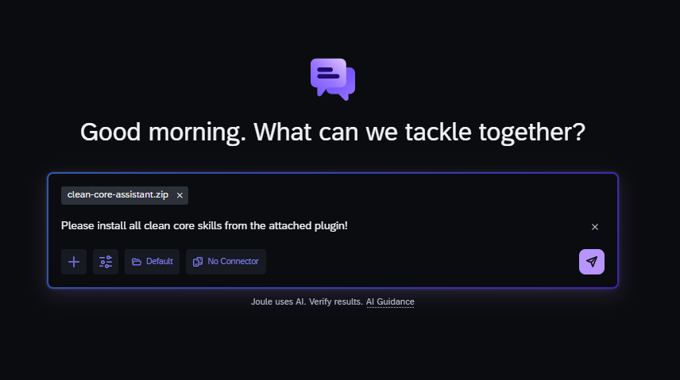
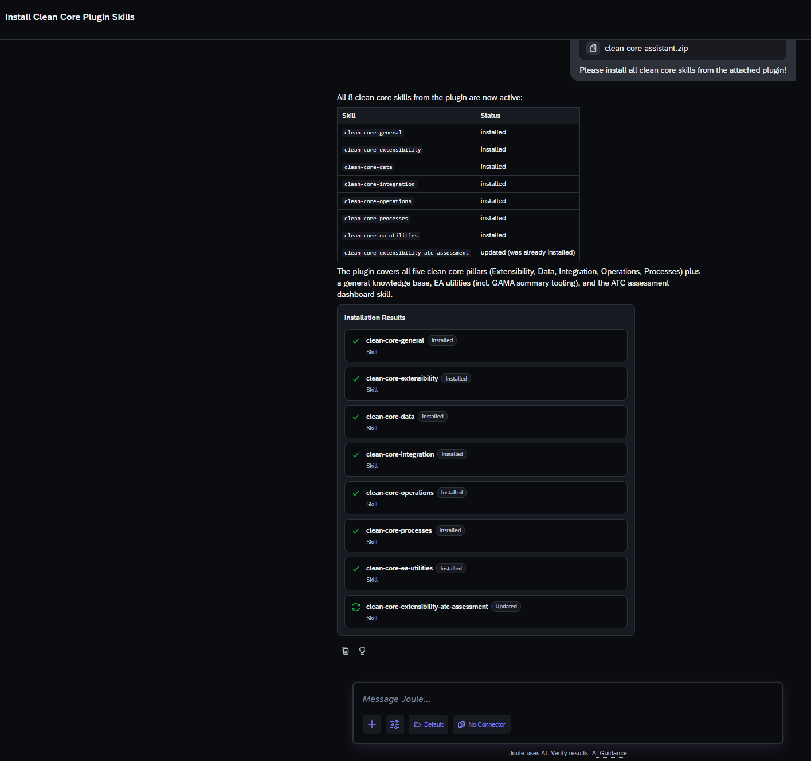
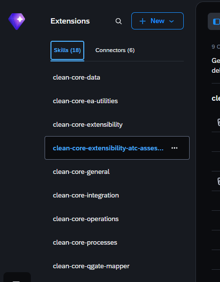
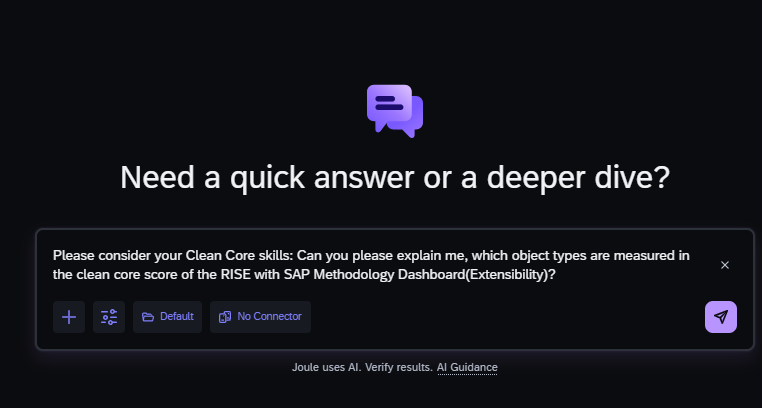
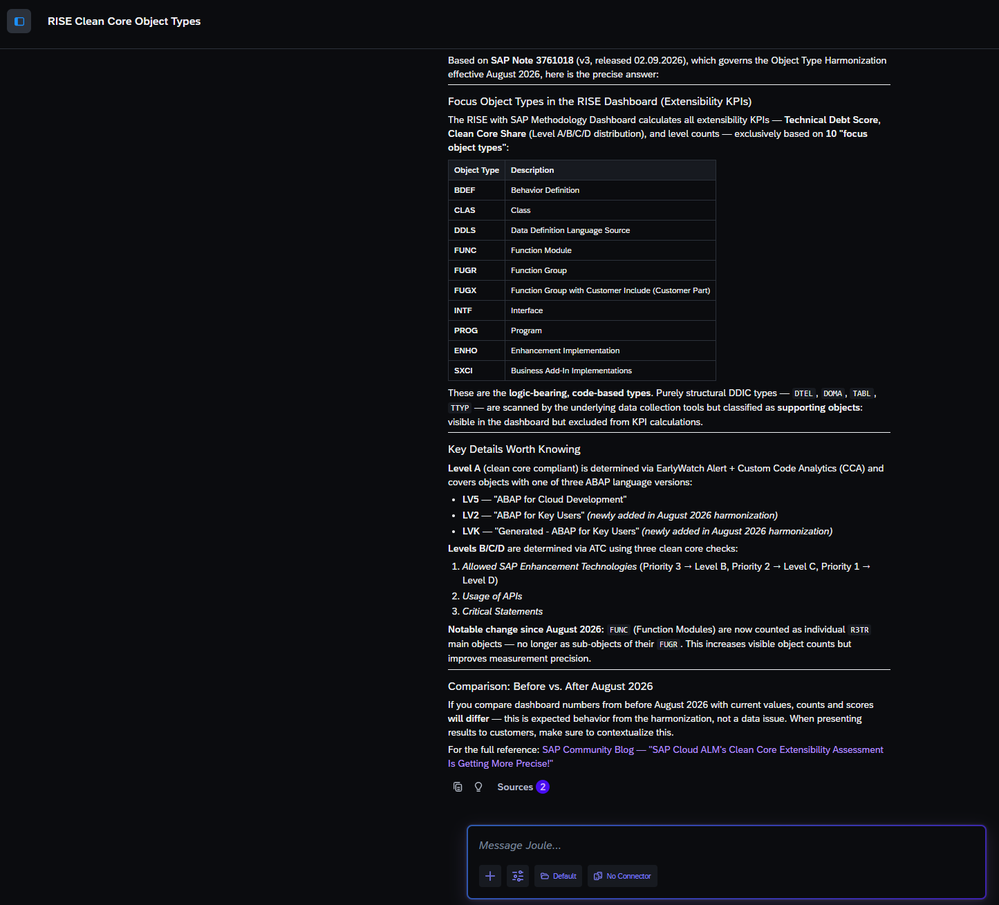
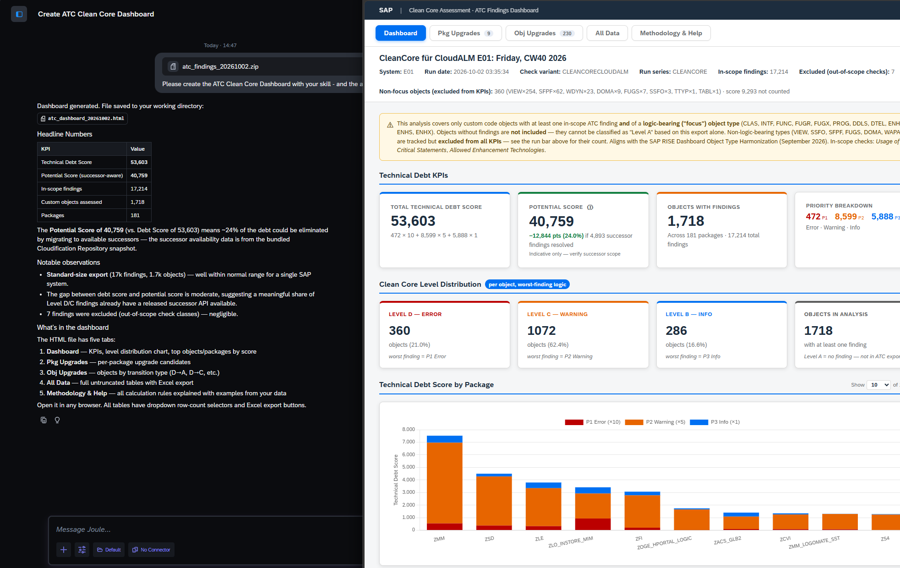

# Clean Core Assistant — AI Plugin

An AI plugin for SAP Enterprise Architects and Architecture Advisors covering all five SAP Clean Core principles. Ask it anything about Clean Core — what it is, how to achieve it, how to measure it, and what the governance practices say. Includes a dedicated tool that generates an ATC assessment dashboard from your system's ABAP Test Cockpit export.

See [CHANGELOG.md](./CHANGELOG.md) for what's new.

---

## Installation — Joule Work Desktop

The fastest way to get all skills running is to install the full plugin package directly from a JWD chat.

**Step 1 — Download the plugin zip**

**Step 2 — Attach it to a new Joule chat**

Open a new chat in Joule Work Desktop, attach the zip file, and ask Joule to install the skills:

> *"Please install all clean core skills from the attached plugin!"*

**Step 3 — Confirm the installation**

Joule will work through the package and ask for confirmation to install each skill. Accept, and it will report back with a status table — all skills should show **installed** (or **updated** if you already have a previous version).

**Step 4 — Start using the skills**

The installed skills appear in your **Extensions** panel. You can now mention them directly in any JWD chat, or simply ask a Clean Core question — Joule will route to the right skill automatically.

---

## Skills included

| Skill | What it covers |
|---|---|
| `clean-core-general` | Entry point for broad and cross-cutting questions. Routes to the right expert skill automatically. |
| `clean-core-extensibility` | Extension levels A–D, ABAP Cloud, ATC, KPIs, Governance & Maturity. |
| `clean-core-integration` | Integration levels A–D, SAP Integration Suite, ISA-M, KPIs, Governance & Maturity. |
| `clean-core-data` | Data strategy, governance, quality, volume efficiency, protection, MDG, BDC, KPIs. |
| `clean-core-operations` | Four cornerstones, cCOE, SAP Cloud ALM, operations KPIs, RISE Dashboard. |
| `clean-core-processes` | Fit to standard, BPM, SAP Activate, fit/gap classification, SSB governance, process KPIs. |
| `clean-core-extensibility-atc-assessment` | **Tool skill.** Generates an HTML ATC assessment dashboard from your system's ATC findings export. |

**How routing works:** Start with `clean-core-general` for broad questions or when unsure which principle applies. The assistant routes to the right expert skill automatically based on the question.

---

## Usage examples

### Example 1 — Asking a knowledge question

> *"Please consider your Clean Core skills: Can you please explain me, which object types are measured in the clean core score of the RISE with SAP Methodology Dashboard (Extensibility)?"*

The skill delivers a structured, source-cited answer:

- A precise table of the **10 focus object types** (BDEF, CLAS, DDLS, FUNC, FUGR, FUGX, INTF, PROG, ENHO, SXCI) with descriptions — the logic-bearing, code-based types that drive all extensibility KPIs
- An explanation of why structural DDIC types (DTEL, DOMA, TABL, TTYP) are **excluded** from KPI calculations
- Key details on how Level A is determined (EarlyWatch Alert + CCA, ABAP language versions LV5/LV2/LVK) and how Levels B/C/D map to ATC check priorities
- A call-out on the **August 2026 Object Type Harmonization** change: FUNC now counted as individual main objects, not sub-objects of FUGR
- Grounded in **SAP Note 3761018 (v3)** and linked directly to the SAP Community Blog post explaining the change

The answer includes a **Sources** indicator showing which knowledge files were used — so you always know where the information comes from.

### Example 2 — Generating an ATC Clean Core Dashboard

> *Attach your ATC findings export (ZIP file from SAP) and ask: "Please create the ATC Clean Core Dashboard with your skill."*

The `clean-core-extensibility-atc-assessment` skill processes the export and generates a self-contained **HTML dashboard** saved directly to your working directory. It is aligned with the RISE with SAP Methodology Dashboard but provides substantially more detail:

**Headline KPIs** (matching the RISE Dashboard calculation):
- Total Technical Debt Score and Potential Score (successor-aware — shows how much debt could be eliminated by migrating to available successor APIs)
- In-scope findings count, custom objects assessed, packages covered

**Clean Core Level Distribution** (per object, worst-finding logic):
- Objects broken down into Level D (P1 Error), Level C (P2 Warning), Level B (P3 Info)
- Percentage share per level across all assessed objects

**Five tabs for deeper analysis:**
1. **Dashboard** — KPIs, level distribution chart, top objects and packages by score
2. **Pkg Upgrades** — per-package upgrade candidates
3. **Obj Upgrades** — objects by transition type (D→A, D→C, etc.)
4. **All Data** — full untruncated tables with Excel export
5. **Methodology & Help** — all calculation rules explained with examples from your own data

The skill also provides a plain-language **summary in the chat** with notable observations — standard size, gap between debt and potential score, any excluded findings — so you can brief stakeholders without opening the HTML file first.

---

## Other AI tools

---

