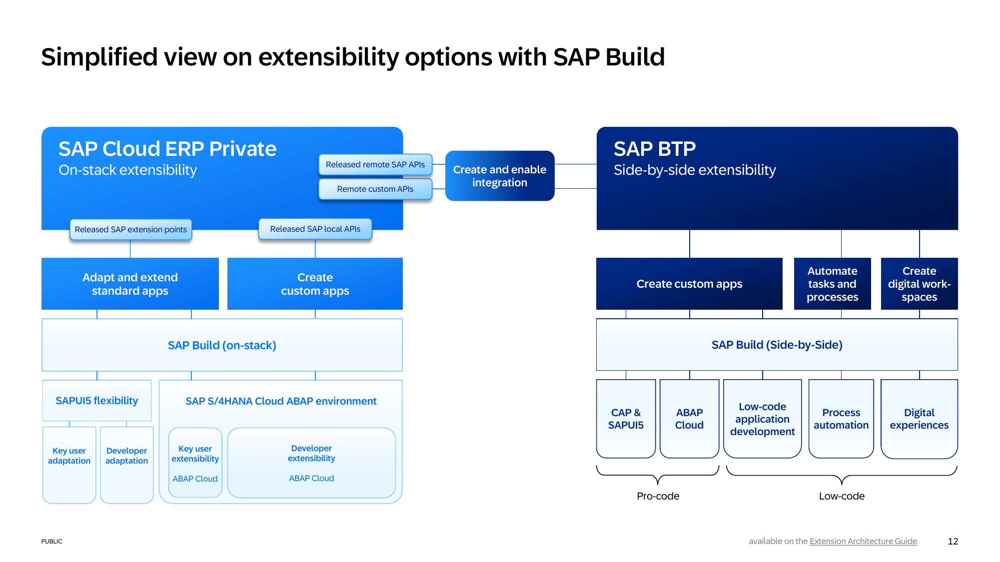
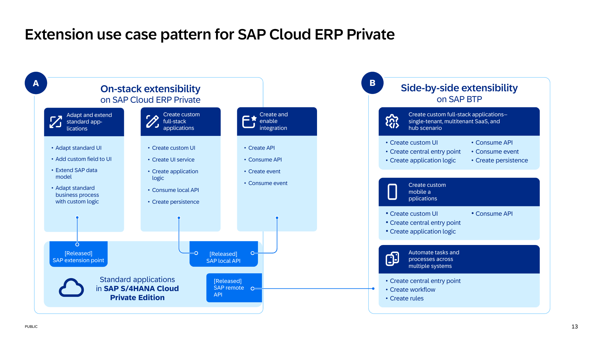
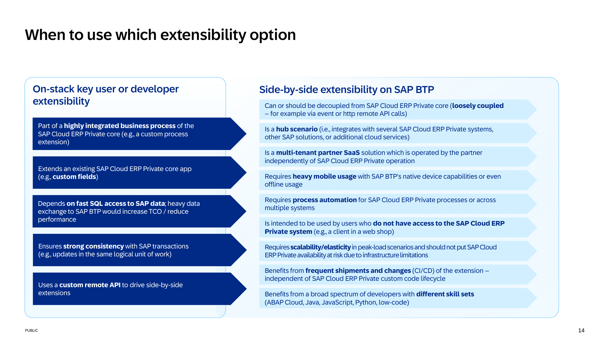
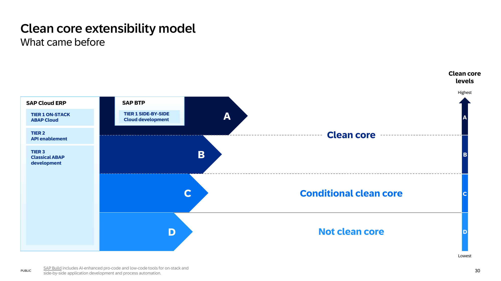
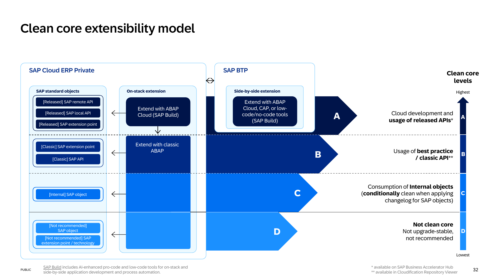
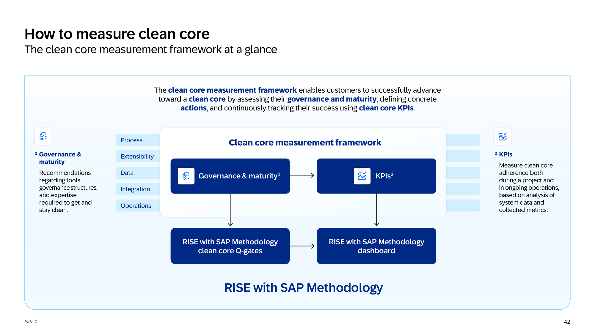
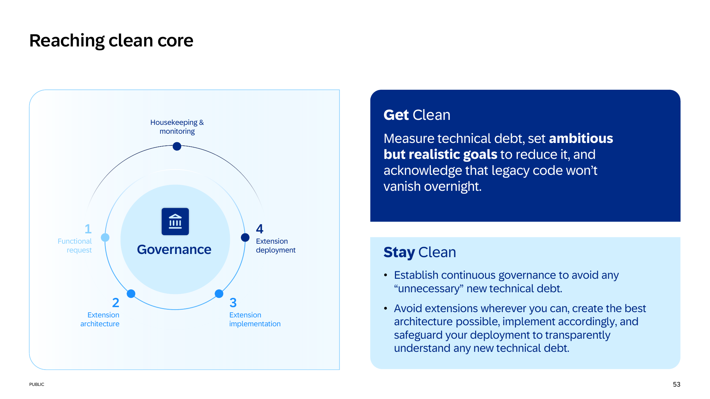
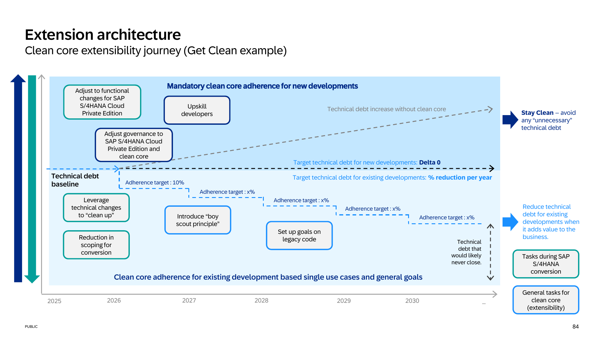

<!-- Source: Clean Core Extensibility L300 Deck (2025) -->
<!-- Authors: Fabian Dias, Alina Iager (SAP) — last modified 2025-12-16 -->

# Source: Clean Core Extensibility L300 Deck (2025)

---

## Sources

When citing content from this file, link to the primary source. This is a publicly available SAP document hosted on the SAP Digital Asset Management (DAM) portal.

| Topic | Source | URL |
|-------|--------|-----|
| All content in this file | Clean Core Extensibility L300 Deck (2025) | https://dam.sap.com/mac/app/p/pdf/asset/preview/yA5pvL8?ltr=a&rc=10&doi=SAP1268127 |
| Clean Core Extensibility overall | SAP White Paper: Clean Core Extensibility (2025) | https://www.sap.com/documents/2024/09/20aece06-d87e-0010-bca6-c68f7e60039b.html |
| ATC setup and governance | SAP Help Portal – ABAP Extensibility Guide | https://www.sap.com/documents/2022/10/52e0cd9b-497e-0010-bca6-c68f7e60039b.html |
| RISE with SAP Methodology Dashboard | RISE with SAP Methodology | https://support.sap.com/en/alm/rise-with-sap-methodology.html |

---

## Agenda

**Why a clean core is important**
- Overcoming obstacles and unlocking innovation

**What a clean core means for extensibility**
- Extensibility is a part of the 5 guiding principles of clean core
- Extensibility options: on-stack and side-by-side
- SAP's clean core level concept
- Partner add-ons and clean core

**How to achieve a clean core for extensibility**
- Clean core measurement framework
- Reaching clean core with "Stay Clean" and "Get Clean"
- Stay Clean: How to create clean extensions
- Get Clean: How to measure the current state
- How to achieve a clean core

---

# Part 1: Why a Clean Core Is Important

## Why a Modern Cloud ERP System Matters

A modern cloud ERP system helps companies operate more efficiently, remain agile in a competitive market, scale with ease, and ensure long-term success. By offering real-time insights, cost savings, and robust security, it empowers businesses to innovate and transform their operations, driving growth and enhancing overall business performance.

**Agility and Flexibility**
- **Why it's Needed:** In today's rapidly changing business environment, companies need the flexibility to adapt to market demands, regulatory changes, and new business opportunities. Traditional on-premises ERP systems can be rigid and difficult to update.
- **Benefit:** Cloud-based ERP systems allow for greater agility, enabling businesses to quickly scale their operations, introduce new processes, or adapt to changes in a more cost-effective and less disruptive way.

**Real-Time Data Access and Decision Making**
- **Why it's Needed:** Businesses often struggle with siloed data, slow decision-making processes, and lack of visibility across departments. Inconsistent or outdated information can lead to costly errors and missed opportunities.
- **Benefit:** Cloud ERP systems provide real-time data access across all departments, ensuring that decision-makers have the most up-to-date information available. This leads to more informed decisions, faster response times, and improved business outcomes.

**Driving Innovation and Securing Growth**
- **Why it's Needed:** Companies need to stay ahead of technological advancements to remain competitive. On-premises systems may become outdated and incompatible with newer tools or trends.
- **Benefit:** Cloud ERP systems are designed to evolve with emerging technologies, such as artificial intelligence, machine learning, and the Internet of Things (IoT). This ensures that businesses can leverage the latest innovations without needing a complete overhaul of their infrastructure.

**Digital Transformation for Competitive Edge:**
As industries rapidly evolve, businesses must adopt technologies that enable agility, speed, and innovation. An ERP solution is no longer a back-office tool — it's a strategic asset that drives business transformation and competitive advantage. Cloud ERPs enable real-time decision-making, faster response times, and data-driven strategies to ensure you can outperform competitors.

---

## Overcoming Obstacles and Unlocking Innovation

In today's fast-changing business environment, agility is key. By adopting standard processes and minimizing customization, companies can respond more quickly to market shifts and new opportunities. A clean core fosters flexibility, allowing businesses to adapt with ease while maintaining operational efficiency.

**Reducing Time to Value:**
One of the major challenges businesses face is the time it takes to realize the benefits of their investments. By following standard processes, organizations can accelerate implementation and see faster returns. Instead of customizing every aspect of their system, companies should prioritize extensions only for processes that truly differentiate their business. This balance between standardization and flexibility ensures efficiency without compromising unique business needs.

**Better Decision-Making & Governance:**
Making the right decisions at the right time is crucial for success. By eliminating unnecessary data and implementing strong data governance practices, organizations can improve data quality, streamline reporting, and enable faster, more informed decision-making. This structured approach to data management enhances overall business performance and reduces risk.

**Unlocking Innovation & Efficiency:**
Innovation is the engine of growth, and a clean core makes it easier to adopt new capabilities, such as Business AI. With frequent and simplified upgrades, organizations can stay ahead of the curve and leverage cutting-edge technologies without the burden of excessive maintenance. This modern approach drives long-term business value and ensures a competitive edge.

**Lower Costs & Reduced Risks:**
Standardizing systems and reducing complexity not only lower maintenance expenses but also minimize operational and cybersecurity risks. A clean core approach ensures that businesses remain compliant with industry standards while avoiding vulnerabilities that come with excessive customization. This strategy ultimately leads to a more secure and cost-effective IT landscape.

---

# Part 2: What a Clean Core Means for Extensibility

## Clean Core: Definition and the Five Guiding Principles

Clean Core is a set of guiding principles designed to support continuous business transformation. Rather than relying on heavy customization, Clean Core focuses on designing ERP systems that are **agile, innovative and efficient**.

Clean Core consists of **5 principles**: Processes, Extensions, Integration, Data, and Operations.

---

## Understanding the Need for Clean Extensions

*(Slide 10 — primarily visual content showing clean vs. non-clean extension patterns)*

**What they are and why they matter:** Clean extensions leverage SAP's public APIs and stable extension points rather than modifying internal SAP objects. They ensure upgradability, supportability, and alignment with SAP's cloud-first strategy.

---

## Simplified View on Extensibility Options with SAP Build

SAP Build provides a unified low-code/no-code environment that covers the main extensibility options (on-stack key user extensions, side-by-side BTP extensions) in an integrated manner.

*Source: L300 Extensibility Deck, Slide 12*

---

## Extension Use Case Pattern for SAP Cloud ERP Private

Defines the recommended architecture patterns for extending SAP Cloud ERP Private Edition, distinguishing between on-stack in-app extensibility and side-by-side extensions on SAP BTP.

*Source: L300 Extensibility Deck, Slide 13*

---

## When to Use Which Extensibility Option

Provides a decision framework to determine whether a given extension use case should be addressed through:
- Key user extensibility (in-app, no-code/low-code)
- Developer extensibility on-stack with ABAP Cloud
- Side-by-side extensibility on SAP BTP

*Source: L300 Extensibility Deck, Slide 14*

---

# Part 3: Clean Core Extensibility Options

## On-Stack Extensibility with ABAP Cloud

### Key User Extensibility Options

Low-code adaptations and extensions available to key users directly within the SAP system, without requiring developer involvement. These include field extensions, custom business objects, UI adaptations, and simple workflow configurations.

---

### ABAP Cloud

ABAP Cloud is the **new ABAP development model** — ABAP Cloud is not a new product. ABAP developers use ABAP Cloud to build cloud-ready apps and extensions on the SAP products:
- SAP BTP ABAP Environment
- SAP Cloud ERP (public and private edition)
- SAP Cloud ERP on-premise

**The main ABAP Cloud elements are:**
- **Core Data Services (CDS)** — for the data model and for embedded analytics
- **The ABAP RESTful Application Programming Model (RAP)** — for building transactional apps
- **The cloud-optimized ABAP language** — for the business logic
- **Mandatory public SAP APIs and extension points** — to allow automated cloud operation
- **ABAP Development Tools (ADT) in Eclipse** — as the ABAP IDE

---

### ABAP Cloud: IDE and API Examples for On-Stack Developer Extensibility

*(Slide 18 — visual diagram showing the ADT tooling and API release state concepts)*

---

### From Classic ABAP to ABAP Cloud

The transformation from classic ABAP to ABAP Cloud involves:
- **Modifications** shall be replaced with **public APIs and extension points** such as Business Add-Ins (BADIs).
- **Dynpro programming** shall be replaced by **SAP Fiori applications** that are implemented based on the ABAP RESTful application programming model.
- **Access to physical SAP tables** shall be replaced by **access to released Core Data Services**.

---

### ABAP Language Versions

*(Slide 20 — visual comparison)*

ABAP supports multiple language versions:
- **Classic ABAP** — full access to SAP internal objects (not suitable for clean core)
- **ABAP for Cloud Development** (ABAP Cloud) — restricted to released APIs only; required for SAP BTP ABAP Environment and extensions that need to be upgrade-stable

---

### Interplay Between ABAP Cloud Development and Classic ABAP

*(Slide 21 — visual diagram)*

Illustrates how ABAP Cloud and classic ABAP co-exist in SAP Cloud ERP Private Edition: classic ABAP is used for existing functionality while new development and extensions should use ABAP Cloud to ensure clean core compliance.

---

### How to Control the Usage of SAP APIs

*(Slide 22 — visual showing ABAP Test Cockpit integration)*

The ABAP Test Cockpit (ATC) enforces API release state checks, preventing developers from using internal SAP APIs. Custom code checks are available to flag violations from clean core compliance.

---

### Detailed Guidance for Classic ABAP Development

*(Slide 23 — visual decision tree / guidance reference)*

Provides detailed guidance on which classic ABAP constructs are permitted and which must be replaced when pursuing clean core compliance. References SAP Note 3578329 for customer-specific decision guidance.

---

## Side-by-Side Extensibility with SAP BTP

### SAP Business Technology Platform

SAP BTP is structured around five key areas:

**AppDev & Automation**
- **Fusion development** — enabling non-classical developers with Low-Code/No-Code tools alongside traditional developers in joint projects
- **Digital workspaces** — providing a central entry page for all tasks (transactional, informational, analytic, collaborative)
- **Process automations** — workflows and task automations that help automate time-consuming human processing

**Data and Analytics**
- Strong persistency layer including multi-model processing and AI-augmented decision making
- Openness to external data sources and AI capabilities
- Business-ready data products without individual modeling efforts
- State-of-the-art tooling for planning and analytics

**Integration**
- Complete enterprise-wide integration platform covering:
  - Application-to-Application (A2A) integration — SAP and non-SAP
  - Business-to-Business (B2B) integration
  - Business-to-Government (B2G) integration
- Event-driven and API-centric scenarios
- Hybrid and pure cloud scenarios; migration support for existing integration infrastructure

**Artificial Intelligence**
- Re-usable AI services for business functions (e.g., AI-based document extraction)
- Tools to create, operate and maintain custom scenarios and interact with foundational/LLM models (SAP or 3rd party)
- Capabilities to store, interact and work with business data and context

**Platform Foundation**
- Modern runtimes and application lifecycle management
- Central security services and compliance support
- Persistency services for custom applications, data, and AI scenarios
- Secure connectivity to any kind of system (public/private cloud, on-premises)
- Platform administration tools and automations

---

### Build Extensions With or Without Code

*(Slide 26 — visual overview)*

Extensions can be built:
- **Visually** — using SAP Build Apps (no-code), SAP Build Process Automation
- **Traditionally** — using Business Application Studio (BAS) with CAP/RAP frameworks
- **With generative AI** — Joule for developers assists code generation within the build experience

---

### App Development and Automation Solutions of SAP BTP

**For professional developers:** SAP Business Application Studio (BAS) supports all modern coding-based development, including application frameworks (CAP or RAP) and development kits for desktop, hybrid, and mobile applications.

**For citizen developers:** SAP Build Apps provides an integrated no-code tool for building apps and extensions using visual programming without coding requirements.

**For consumption:** SAP Launchpad provides a mobile-enabled, personalized central entry-point to applications, tasks, and process information. SAP Build Work Zone goes further to provide a complete integrated digital workplace.

---

### SAP Build

SAP Build is fully integrated with the SAP Business Suite, SAP Business Data Cloud, and SAP Business AI.

**Extension Layer:** SAP Build is the governed extension layer — enabling clean core development across apps, workflows, AI agents, and digital workspaces. Whether teams are working code-first, low-code, or with embedded AI, they can build and ship up to **3x faster** without compromising standards or control.

**Embedded AI:** Joule for developers brings generative AI directly into the build experience. Powered by SAP's proprietary models and trained on real business logic — helping teams generate secure, contextual code and logic with speed and confidence.

**Pre-built Content:** SAP Build includes over **500 pre-built solutions** spanning finance, HCM, supply chain, procurement, and more. These are enterprise-ready templates from SAP and partners — designed to be adapted, not started from scratch.

SAP Build is part of SAP Business Technology Platform, which enables even the most complex organizations to create a fully integrated, agile foundation for developing data-driven solutions and meaningfully scaling AI.

---

# Part 4: The Clean Core Level Concept

## Clean Core Extensibility Model: What Came Before

The previous extensibility model did not differentiate between modification-based (non-upgradable) and API-based (upgrade-safe) extensions. The new model introduces explicit levels to guide customers on their clean core journey.

*Source: L300 Extensibility Deck, Slide 30*

---

## Clean Core Extensibility Launch: The New Approach

The new extensibility model differentiates between:
- **Level A** — Public Cloud best practices (strictest, fully upgrade-safe)
- **Level B/C** — Private Cloud best practices (intermediate; allows some classic ABAP with defined restrictions)
- **Level D** — Classic, non-upgrade-safe extensions (to be eliminated)

---

## Clean Core Extensibility Model

The model defines four levels (A, B, C, D) that indicate the degree of clean core compliance for each extension. The levels serve as a classification and governance tool.

*Source: L300 Extensibility Deck, Slide 32*

---

## Definition of Qualifiers

*(Slide 33 — visual table)*

Each extension is qualified based on:
- The type of SAP object accessed (released API vs. internal object)
- The extension technique used (standard extension point vs. modification)
- The impact on upgrade stability

---

## Level A — Fully Clean Core Compliant

**Cloud development and usage of released APIs**

Extensions only referencing released SAP objects (100% cloud compliant, 100% clean core); can be achieved on-stack, side-by-side or hybrid.
- Only released SAP APIs and extension points are used
- No modifications to SAP standard code
- Extensions are fully upgrade-safe
- Recommended for SAP Cloud ERP Public Cloud and as the target state for Private Cloud

---

## Level B — Clean Core Compliant with Classic APIs

**Usage of best practice / Classic APIs**

Objects that are nominated as classic APIs. Classic APIs have no contractual upgrade stability but are still nominated and recommended by SAP.
- Primarily API-based with minor legacy constructs
- Upgrade risk is low but not zero
- Part of the accepted path for Private Cloud customers transitioning to clean core

---

## Level C — Partially Clean Core Compliant

**Consumption of internal objects**

Custom objects that do NOT refer to any "not recommended" object from Level D — but can also use "Internal" SAP objects that are not nominated as "Classic API".
- Some internal SAP objects may be accessed
- Upgrade risk is moderate
- Customers at Level C should have a roadmap to reach Level B or A

---

## Changelog Approach: Dependency Between SAP Internal and Custom Objects

*(Slides 37 & 38 — visual)*

The changelog tracks the dependency between SAP internal objects and customer/partner custom objects. When SAP changes or removes an internal object, the changelog identifies which custom objects are affected, enabling proactive remediation before upgrades.

---

## Level D — Not Clean Core Compliant

**Not recommended use of SAP objects**

Extensions leveraging objects explicitly marked as "not recommended" by SAP (e.g., upgrade issues expected, potential scope items in compatibility scope or deleted objects).
- Direct modifications to SAP standard code (modifications, user exits that bypass standard APIs)
- High upgrade risk; may break during SAP updates
- Must be eliminated or refactored to reach clean core

---

## How the Changelog Supports Your Clean Core Journey

*(Slide 40 — visual)*

The changelog capability in SAP Cloud ERP provides customers with:
- Visibility into which of their custom objects depend on SAP internal objects
- Early warning when SAP changes internal objects in upcoming releases
- Actionable insights to prioritize remediation work and maintain upgrade readiness

---

# Part 5: How to Achieve a Clean Core for Extensibility

## The Clean Core Measurement Framework

The **Clean Core Measurement Framework** guides customers toward a clean core by assessing their **governance and maturity**, defining concrete **actions**, and continuously tracking their success using **clean core KPIs**.

*Source: L300 Extensibility Deck, Slide 42*

**Governance and Maturity approach:**
- Provides recommendations regarding tooling, governance, and know-how required to get and stay clean
- Determines the current clean core score for each clean core dimension
- A target score can also be determined based on the customer's ambition and strategic objectives
- The calculation of the current score is based on several evaluation criteria grouped into practices
- The assessment can be done at any point in time: before, during, or after transformation
- It is possible to select which dimensions and practices are assessed
- Evaluation criteria will be included in the RISE with SAP Methodology and are planned to be available as part of Q-Gates

**KPIs:**
- Measure clean-core adherence during a project or during the operation phase
- Derived from analysing system data or data points collected
- All KPIs that can be automated will be made visible in the RISE with SAP methodology dashboard

**Analogy:** Think of the framework like a personal fitness plan. The governance and maturity areas (nutrition, exercise, mental health) represent the principles to follow, while KPIs (water intake, distance run, minutes meditating) measure how well you adhere to those principles.

---

## Clean Core Governance and Maturity

### Extensibility Governance — Practices Overview (Governance Maturity)

*(Slide 44/45 — visual practices breakdown)*

The governance maturity assessment for extensibility covers practices across multiple dimensions that guide customers on how to govern their extension landscape effectively.

---

### Extensibility Governance — System Setup Practices Overview

*(Slide 46 — visual)*

System setup practices ensure the technical prerequisites are in place to enable clean core measurement and governance.

---

### Governance and Maturity — Result Example

The assessment produces a scored result per practice:

| Practices | Importance | Current Score | Target Score |
|-----------|-----------|--------------|--------------|
| Maturity of governance process for extensions | High | 0–5 | 0–5 |
| Maturity of extension architecture guidelines | High | 0–5 | 0–5 |
| Maturity of development guidelines | High | 0–5 | 0–5 |
| Maturity of developer skills & enablement | High | 0–5 | 0–5 |
| Maturity of measurements & KPIs | High | 0–5 | 0–5 |
| Maturity of housekeeping practice | Medium | 0–5 | 0–5 |
| Maturity of scoping process for custom code adoption (conversion-only) | Medium | 0–5 | 0–5 |

**System Setup Practices:**

| Practices | Importance | Current Score | Target Score |
|-----------|-----------|--------------|--------------|
| Setup of automated code checks | High | 0–5 | 0–5 |
| Setup of exemption process | High | 0–5 | 0–5 |
| Setup for ABAP Cloud | Medium | 0–5 | 0–5 |
| Setup of usage data collection | Medium | 0–5 | 0–5 |
| Setup of SAP BTP account for clean core extensibility | Low | 0–5 | 0–5 |

---

### Clean Core Extensibility: Governance and Maturity — Detailed Information

*(Slide 48 — visual with detailed practice descriptions)*

Provides detailed descriptions of each governance practice, including what constitutes each maturity level (0–5 scoring criteria) and recommendations for improvement.

---

## Measurability: Performance KPIs

*(Slide 49 — section header)*

Addresses what can be measured to assess clean core compliance for extensibility.

---

## Clean Core Context — Extensibility

*(Slide 50 — visual context diagram)*

Positions extensibility KPIs within the broader clean core measurement context, showing how extension-specific KPIs relate to the five clean core dimensions.

---

## Clean Core Extensibility — KPIs at a Glance

Extensibility KPIs serve different stakeholder needs:

| KPI | Metric | Stakeholder need |
|-----|--------|-----------------|
| **Clean core share** | % of code objects per clean core level | "As the CIO, I need to understand that my transformation team is following a clean core mindset with regard to extensibility." |
| **Technical debt score** | Score of technical debt per custom object | "As the CTO, I need to understand the degree of technical debt in the extensions of my organization." |
| **Unused code share** | % of unused custom code | "As the CSO, I need to understand the excess of unused coding to assess associated risks." |
| **Business modifications** | # of business modifications to SAP standard objects | "As Upgrade Project Manager, I need to estimate the adjustment effort caused by modified SAP standard objects during upgrade events." |

All KPIs are available in the RISE with SAP Methodology clean core Q-gates and RISE with SAP Methodology dashboard.

---

## Extensibility KPIs Overview

*(Slide 52 — detailed KPI table, primarily visual)*

Comprehensive list of KPIs used to measure extensibility clean core compliance, including:
- Percentage of extensions at Level A/B/C/D
- Number of modifications / open modification items
- Custom code usage and activation rates
- Extension remediation progress over time

---

# Part 6: Reaching Clean Core

## Reaching Clean Core: Stay Clean and Get Clean

The central framework slide showing the two complementary paths to clean core: **Stay Clean** (prevent new technical debt) and **Get Clean** (reduce existing technical debt), embedded within the continuous governance cycle of Functional Request → Extension Architecture → Extension Implementation → Extension Deployment, plus Housekeeping & Monitoring.

*Source: L300 Extensibility Deck, Slide 53*

---

## Stay Clean: Creating Clean Extensions

*(Slide 54 — section header)*

"Stay Clean" covers how to ensure that **new extensions** being created comply with clean core principles from the outset.

---

## How to Set Up a Continuous Governance Process

A continuous governance process for clean extensions involves these steps:

1. **Functional Request** — Ensure the requirement fits the right SAP process context; gather requirements in the right business context and link to processes using SAP Cloud ALM; check if the extension is valuable, has a clear business case, and apply pace layering (standard/differentiating/innovative); make-or-buy decision
2. **Extension Architecture** — Identify and design the optimal extension architecture using the SAP Application Extension Methodology; map extension tasks to technical building blocks; choose best-fit technologies; acknowledge, approve, and document decisions using guidance assets and templates
3. **Extension Implementation** — Adopt a clean core mindset; write future-proof code; focus on reuse; develop and follow development guidelines; upskill to ABAP Cloud and modern SAP extensibility through learning journeys and certifications; plan clean extensions by identifying SAP standard touchpoints and using released extension points (Level A) first
4. **Extension Deployment** — Enforce clean core rules automatically by integrating ATC checks into transport release and blocking non-compliant code until fixed or approved; manage exceptions formally with clear justification, tracking in ATC, expiry dates, and regular reviews; restrict ABAP usage by applying ABAP Cloud language version, role separation, and API checks; safeguard stability by creating wrappers for legacy objects and running ABAP unit tests; promote transparency by sharing findings and lessons learned

---

## Process Segmentation

*(Slide 58 — visual)*

Extensions are categorized by process segment to allow targeted governance. Not all processes require the same level of extension restriction — differentiation is made based on business criticality and differentiation value.

---

## How to Handle a Business Requirement

*(Slide 59 — decision guidance)*

Defines the structured process for evaluating a new business requirement:
1. Can the requirement be met by standard SAP functionality? → Use standard
2. Can it be met by key user extensibility (in-app, no-code)? → Use key user tools
3. Does it require developer-level extension? → Choose ABAP Cloud (on-stack) or BTP (side-by-side) based on use case
4. Is modification unavoidable? → Document, justify, and plan remediation to Level B/A

---

## Clean Core Governance Preparation: Create Tag Groups and Tags

*(Slide 60 — visual screenshot)*

Process tagging in SAP Cloud ERP enables customers to associate extensions with specific business processes, supporting:
- Traceability from business requirement to technical implementation
- Process-based reporting and governance
- Identification of extension hot spots by process area

---

## Clean Core Governance Preparation: Activate Tag Display

*(Slide 61 — visual screenshot)*

Tag display activation enables visibility of process associations directly within the system, supporting day-to-day governance by developers and architects.

---

## Clean Core Reporting: Tagged Solution and Customer Processes

*(Slide 62 — visual screenshot)*

Reports on the current state of process tagging across the system, showing which processes have associated extensions and their clean core level classification.

---

## Analytics: Check Correctness of Tagging

*(Slide 63 — visual)*

**Example solution process traceability: Top-down check by pop-up**

Provides analytical capabilities to validate that extensions are correctly tagged and that the clean core level assignments are accurate and consistent.

---

## SAP Application Extension Methodology (AEM)

*(Slide 65 — storyline notes)*

The goal is to **choose the best possible architecture** for each extension:
- First step: choose the right extension domain
- Structured approach based on AEM: offering a structured path from Requirement to Architecture
- Most important element: **Extension Task** (as abstraction layer) → **Technology Building Block Mapping**, based on color-coding that is reflected in general governance (e.g., approval process)

---

## SAP Application Extension Methodology (AEM) — Detail

*(Slide 66 — visual overview diagram)*

AEM provides a structured methodology for:
1. **Identifying** the extension requirement (what needs to be extended)
2. **Classifying** the extension task type (e.g., additional fields, workflow, report, UI change)
3. **Mapping** extension tasks to the appropriate technology building block (key user tools, ABAP Cloud, BTP services)
4. **Governing** through color-coded risk classification (green = clean, yellow = caution, red = non-clean)

---

## Decision Guidance Per Extension Task (Customer-Specific)

*(Slides 67 & 68 — visual decision tables)*

Provides detailed, customer-configurable decision guidance for each extension task type. Reference: SAP Note 3578329 (https://me.sap.com/notes/3578329)

---

## Extension Implementation: Overview

*(Slide 70 — section overview visual)*

The extension implementation guidance covers the full lifecycle from mindset to tooling:
1. Establish a clean core mindset
2. Development guidelines
3. Skill development
4. Developing clean extensions (with governance tooling)

---

## Extension Implementation: Establish a Clean Core Mindset

*(Slide 71 — visual)*

Establishing a clean core mindset means:
- Defaulting to standard SAP functionality before considering extensions
- Treating extensions as exceptions that require justification
- Understanding that upgrade stability is a primary design constraint
- Aligning development culture with SAP's evolution toward cloud-native architecture

---

## Extension Implementation: Development Guidelines

*(Slide 72 — visual)*

Key development guidelines for clean extensions:
- Use only released SAP APIs (C1/released status in ABAP)
- Avoid accessing SAP internal database tables directly; use released CDS views
- Implement business logic using RAP (ABAP Cloud) or CAP (BTP)
- Use BADIs and published extension points for hook-based extensions
- Keep side effects minimal and follow SAP's extensibility framework contracts

---

## Extension Implementation: Skill Development

*(Slide 73 — visual)*

Clean core development requires upskilling in:
- ABAP Cloud / RAP programming model
- SAP BTP services (CAP, SAP Build Apps, SAP Build Process Automation)
- SAP API ecosystem (Business Accelerator Hub, API Management)
- ATC and clean core tooling in ADT

---

## Extension Implementation: Developing Clean Extensions

*(Slides 74–77 — visual step-by-step guide)*

Covers the practical steps for developing clean extensions:
- Using ABAP Cloud development objects (classes, interfaces, CDS views)
- Implementing RAP business objects with proper lifecycle management
- Connecting BTP extensions to SAP Cloud ERP via stable integration APIs
- Testing extensions with ATC checks to verify clean core compliance
- Documenting extensions with appropriate process tags and level classification

---

## Example Setup for Separation of ABAP Cloud / Classic ABAP

*(Slide 78 — visual architecture diagram)*

Recommended setup for SAP Cloud ERP Private Edition:
- Separate software components for ABAP Cloud development (restricted language version) and classic ABAP (where still required)
- ABAP Cloud components cannot reference classic ABAP internal objects
- Enforces clean boundaries and prevents accidental use of non-released APIs
- Supports gradual migration: classic ABAP component can be reduced over time

---

## Clean Core Governance Options

*(Slide 80 — visual overview)*

Governance options for clean core compliance include:
- **Automated code checks** via ATC (ABAP Test Cockpit)
- **Exemption process** for justified deviations with time-bound approvals
- **Dashboard monitoring** via RISE with SAP Methodology Dashboard
- **KPI tracking** with trend analysis over time
- **Process tagging** for business process traceability

---

## New ABAP Test Cockpit Check Based on Usage Guidelines for SAP APIs

*(Slide 81 — visual screenshot)*

A new ATC check validates that custom code only uses SAP APIs with the correct release state. This check:
- Automatically flags usage of internal (unreleased) SAP APIs
- Provides remediation guidance pointing to equivalent released APIs
- Can be configured with exemptions for justified legacy cases
- Is integrated into the CI/CD pipeline for continuous validation

---

## Use ABAP Test Cockpit for Clean Core Governance

**Setup steps:**
1. **Remote ABAP test cockpit**: Connect DEV systems to the central ABAP test cockpit system
2. **Configure ATC** to run during development tasks and at transport release
3. **Block priority 1 and priority 2 findings** for transport

**Set up ATC check variant:**
- Copy the ATC variant `ABAP_CLOUD_DEVELOPMENT_DEFAULT`
- Add the following checks:
  - Allowed SAP enhancement technologies
  - Usage of APIs
  - Code Pal checks for clean ABAP
  - Search for customer modifications
  - SAP Code Vulnerability Analyzer (if licensed)
  - Critical statements
- Suppress findings in legacy objects that cannot be adopted
- Request exemptions if SAP PUBLIC APIs are still needed to control their usage

---

# Part 7: Get Clean — Measuring the Current State

## Get Clean: Measuring the Current State of Clean Core

*(Slide 83 — section header)*

"Get Clean" addresses how to measure the **existing extension landscape** and prioritize remediation work to achieve clean core compliance.

---

## Extension Architecture: Clean Core Extensibility Journey (Get Clean Example)

The Get Clean journey is not an overnight exercise. The diagram shows a realistic multi-year timeline (2025–2030+) with two parallel tracks:

- **Upper track (Stay Clean)**: Mandatory clean core adherence for new developments, target technical debt delta 0
- **Lower track (Get Clean)**: Incremental reduction of technical debt in existing code, with annual adherence targets (starting at 10%)

**Tasks during SAP S/4HANA conversion** (teal boxes — highest leverage, do these first):
- Adjust to functional changes for SAP S/4HANA Cloud Private Edition
- Adjust governance to SAP S/4HANA Cloud Private Edition and clean core
- Reduction in scoping for conversion

**General tasks for clean core (extensibility)** (blue boxes — ongoing):
- Upskill developers
- Leverage technical changes to "clean up"
- Introduce "boy scout principle"
- Set up goals on legacy code

The dashed line shows the technical debt that would accumulate without clean core — the gap widens significantly over time.

*Source: L300 Extensibility Deck, Slide 84*

---

## RISE with SAP Methodology Dashboard

*(Slide 85 — section header)*

The RISE with SAP Methodology Dashboard is the central tool for monitoring clean core compliance. It replaced the previous SAP for Me dashboard (sunset end of March 2025) and is now available on **SAP Cloud ALM**.

---

## Multiple Views for Different Audiences

*(Slide 86 — visual)*

The dashboard provides different views tailored to different stakeholders:
- **System View** — technical detail for architects and developers
- **Operations View** — operational status for IT operations teams
- **Executive View** — high-level KPI trends for management

---

## RISE with SAP Methodology Dashboard on SAP Cloud ALM

The Clean Core dashboard in SAP for Me was **sunset end of March 2025**. The dashboard is now available on SAP Cloud ALM.

---

## RISE with SAP Methodology Dashboard — System View

**Access requirements:**
- Administrator must create the required role collection with the role template `rdp_dashboard_ccSystemViewer` and assign it to users
- The dashboard supports SAP Cloud ERP systems in production, test, and development — only fully set-up systems can be selected
- If the SAP Cloud ALM tenant has multiple customer numbers assigned, only systems linked to customer numbers eligible for RISE with SAP are visible
- Supports only **SAP Cloud ERP** and **SAP Cloud ERP Private** systems — does not support SAP ERP (on-premise)

---

## RISE with SAP Methodology Dashboard — Available Views

*(Slide 89 — visual)*

Available views include:
- System View (clean core tool status, extension details)
- Operations View (operational KPIs)
- Portfolio View (cross-system comparison — roadmap item)

---

## System View — Clean Core Tool Status

The cards under "Clean Core Tool Status" show the status of the tools needed to collect clean core-related data. Each tool provides data necessary for measuring the clean core compliance of your system.

---

## System View at a Glance

- **Access** a detailed overview of system adherence and optimization opportunities
- **Analyze** detailed insights and data on the clean core status of your systems
- **Manage** system extensibility to identify deviations from SAP's recommendations and prepare for future upgrades

---

## Operations View at a Glance

*(Slide 92 — visual with operational KPI cards)*

The Operations View provides a time-series perspective on clean core KPIs, enabling teams to track progress and identify regressions between upgrade cycles.

---

## Consideration of the Level Concept

*(Slide 93 — visual)*

The dashboard incorporates the clean core level concept (A/B/C/D), showing the distribution of extensions across levels and the trend over time. Customers can set target level distributions and track progress toward those targets.

---

## RISE with SAP Methodology Dashboard — Roadmap

| Quarter | Planned Enhancements |
|---------|---------------------|
| **Q4 2025** | Consideration of the level concept; display of data volume efficiency KPIs; grouping of extensibility data into levels A–D; include summary from governance and maturity questions; add Operations setup score |
| **Q1 2026** | Provide deep dive dashboard for extensibility; display security score; add project view; provide aggregated summary on extensibility, data, and integration in Executive View |
| **Q2 2026** | Enhance Executive View with process dimension; enhance analytics API for customer data export; include Landscape View with integration KPIs; provide data quality insights; display usage of integrated toolchain |

---

## Measuring Clean Core: Project Specifics

*(Slide 95 — section header)*

Project-specific measurement covers how to use clean core KPIs during an active transformation project (as opposed to steady-state operations).

---

## When to Use Projekt Kernseife in Addition to Standard SAP Tools

*(Slide 96 — visual decision guide)*

**Projekt Kernseife** is a community-developed tool that provides additional clean core analysis capabilities beyond the standard SAP tooling. It is recommended:
- For deep-dive analysis of legacy custom code portfolios
- When more granular classification is needed than the standard ATC reports provide
- During initial baseline assessments before the RISE dashboard is fully set up

---

# Part 8: Partner Certification

## Clean Core Certification Program for Partner Extensions

*(Slide 98 — visual)*

SAP has introduced a **clean core certification program** for partner extensions (ISV add-ons). Key aspects:
- Partners must demonstrate that their extensions comply with clean core levels (targeting Level A or B)
- Certification is visible to customers, enabling informed decisions about which partner products to adopt
- Certified partner products are listed in the SAP Store with clean core level indicators
- Recertification is required when the partner extension is updated for new SAP releases

---

# Part 9: Summary and Resources

## Summary: Clean Core Extensibility Model

The clean core extensibility approach consists of two tracks:

**Stay Clean (new extensions):**
- Use AEM to select the right technology for each extension task
- Follow development guidelines (ABAP Cloud, BTP CAP, key user tools)
- Enforce compliance via ATC automated checks
- Govern through process tagging and approval workflows

**Get Clean (existing extensions):**
- Assess current state using ATC and the RISE with SAP Methodology Dashboard
- Classify existing extensions into levels A/B/C/D
- Prioritize and execute remediation of Level C and D extensions
- Track progress using clean core KPIs

---

## FAQ and Further Learning Resources

*(Slide 100 — links and FAQ, visual)*

Key resources for clean core extensibility:
- SAP Note 3578329: Decision guidance per extension task — https://me.sap.com/notes/3578329
- RISE with SAP Methodology Dashboard on SAP Cloud ALM
- SAP Business Accelerator Hub (API catalog): https://api.sap.com
- SAP Learning Hub: ABAP Cloud and Clean Core courses
- SAP Community: Clean Core extensibility discussion threads

---

*End of L300 Deck content extraction.*
